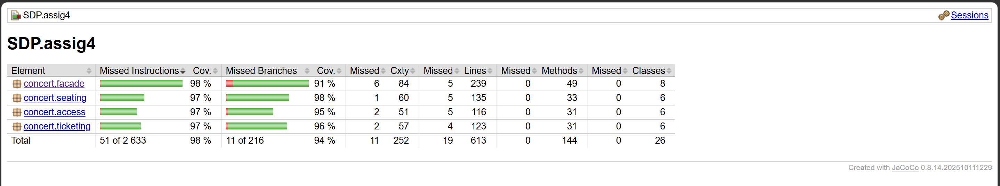
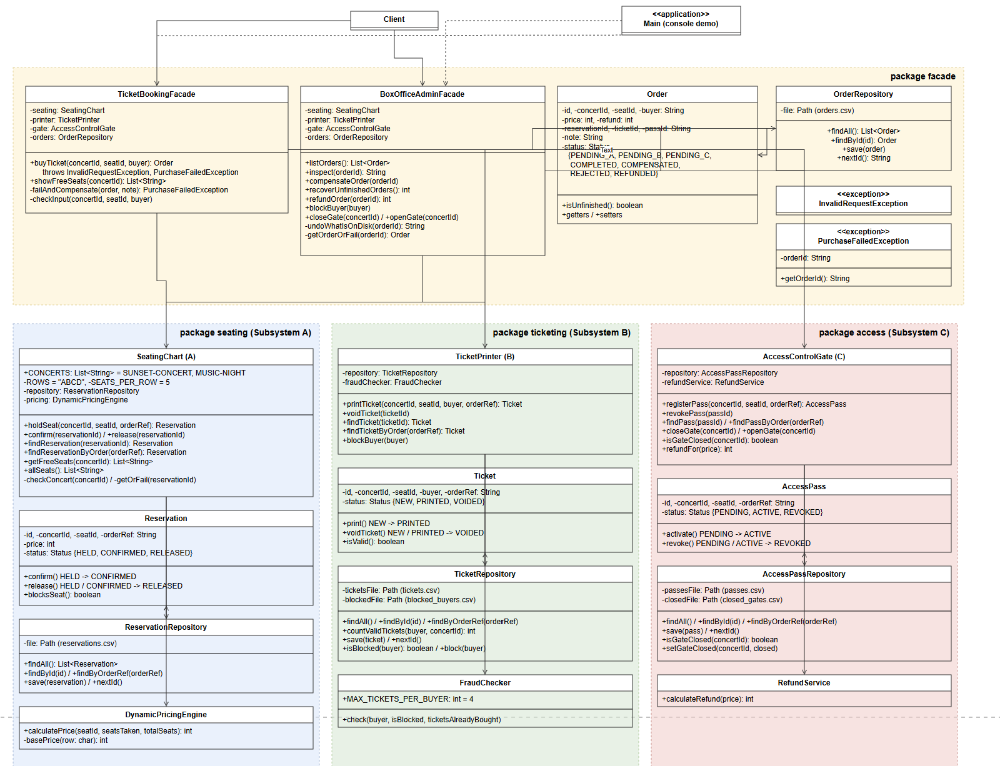

# Assignment 4 – Concert Ticketing

A customer buys one concert ticket. Three separate subsystems work one after another, and one facade hides this from the client:

- **A (seating)** holds the seat and calculates the price.
- **B (ticketing)** checks the buyer and prints the ticket.
- **C (access)** registers the pass at the gate.

Concerts: `SUNSET-CONCERT`, `MUSIC-NIGHT`. Hall: rows `A`–`D`, seats `1`–`5`.

## How to run

Needs Java 17+ and Maven. Run the commands in the folder with `pom.xml`.

```
mvn compile exec:java   # start the console demo
mvn test                # run tests + make the coverage report
```

**Reset the data:** stop the program and delete the `data/` folder.

## 3.1 Three subsystems

Each subsystem has 4 classes and uses no class from the other two.

| | A – `seating` | B – `ticketing` | C – `access` |
|---|---|---|---|
| Main class | `SeatingChart` | `TicketPrinter` | `AccessControlGate` |
| Entity + status | `Reservation`: HELD, CONFIRMED, RELEASED | `Ticket`: NEW, PRINTED, VOIDED | `AccessPass`: PENDING, ACTIVE, REVOKED |
| Saves to disk | `ReservationRepository` | `TicketRepository` | `AccessPassRepository` |
| Pure business logic | `DynamicPricingEngine` | `FraudChecker` | `RefundService` |

Every entity checks by itself which status changes are allowed (for example, a released reservation cannot be confirmed). Every subsystem can be used alone, without the facade – each one has its own tests.

## 3.2 Two facades

- `TicketBookingFacade` – for the customer. `buyTicket()` runs A → B → C and decides what to undo if a step fails.
- `BoxOfficeAdminFacade` – for the box office. Inspect an order, refund, compensate by hand, recover after restart, block a buyer, close/open the gate.

Both use `ChainCompensator`, so the rollback rules are written only once.

## 3.3 Durable state

Everything is saved as CSV files in `data/` (reservations, tickets, passes, orders, blocked buyers, closed gates). Nothing is kept only in memory.

The facade saves the **order** before step A and after every step. Its status shows how far the chain got:

`PENDING_A` → `PENDING_B` → `PENDING_C` → `COMPLETED`

Other end states: `COMPENSATED`, `REJECTED`, `REFUNDED`.

If the program stops in the middle, the order stays `PENDING_*`. At the next start `recoverUnfinishedOrders()` finds it, looks at what really exists on disk in A, B and C, and undoes it.

## 3.4 Compensation (two depths)

| Failure | How to make it happen | What is undone | Order status |
|---|---|---|---|
| **B fails** after A | buyer is blocked or has 4 tickets already | release the seat (A) | `COMPENSATED` |
| **C fails** after A and B | gate of the concert is closed | void the ticket (B), then release the seat (A) | `COMPENSATED` |

`ChainCompensator` does not trust variables in memory. It reads the disk and undoes in the order C → B → A. The same code is used for a live failure and for recovery after a restart.

## 3.5 Principle of Least Knowledge

**Before** (no facade): the client knows three subsystems and the rollback order.

```java
Reservation reservation = seating.holdSeat("SUNSET-CONCERT", "A1", "ORD-1");
Ticket ticket;
try {
    ticket = printer.printTicket("SUNSET-CONCERT", "A1", "Anna", "ORD-1");
} catch (BuyerRejectedException e) {
    seating.release(reservation.getId());
    throw e;
}
AccessPass pass;
try {
    pass = gate.registerPass("SUNSET-CONCERT", "A1", "ORD-1");
} catch (GateClosedException e) {
    printer.voidTicket(ticket.getId());
    seating.release(reservation.getId());
    throw e;
}
seating.confirm(reservation.getId());
```

The client has many "friends": `SeatingChart`, `Reservation`, `TicketPrinter`, `Ticket`, `AccessControlGate`, `AccessPass`.

**After** (with facade): the client has one friend.

```java
Order order = booking.buyTicket("SUNSET-CONCERT", "A1", "Anna");
```

If something fails, the facade has already cleaned up and throws `PurchaseFailedException`.

## 3.6 Exception handling

Other failures besides B and C:

- **Step A fails** (seat taken, unknown seat or concert) → nothing to undo, order is `REJECTED`.
- **Bad input** (short name, empty seat, a comma in the text) → `InvalidRequestException`, nothing is saved.
- **The rollback itself fails** → order stays `PENDING_*` and recovery finishes it at the next start.

Own exceptions: `SeatUnavailableException` (A), `BuyerRejectedException` (B), `GateClosedException` (C), `InvalidRequestException` and `PurchaseFailedException` (facade).

## 3.7 Unit tests

64 tests (JUnit 5).

| Test class | What it checks |
|---|---|
| `TicketBookingFacadeTest` | happy path, B fails, C fails (with call order), step A errors, bad input, failing rollback |
| `BoxOfficeAdminFacadeTest` | refund, manual compensation, inspect, open gate |
| `PersistenceReloadTest` | restart in the middle of the chain (after A, after B, after C), recovery reads the disk |
| Subsystem tests | each subsystem alone, without the facade |

**F.I.R.S.T.**
- Fast – only small CSV files.
- Independent / Repeatable – each test uses its own `@TempDir`, so it starts clean.
- Self-validating – only assertions.
- Timely – tests are committed together with the code (see Git history).

**Testing language.** `ConcertWorld` has helper methods, so a test reads like a sentence:

```java
world.givenGateIsClosed();
PurchaseFailedException e = world.whenBuyingFails("Clara", "C3");
world.thenTicketIs(e.getOrderId(), Ticket.Status.VOIDED);
world.thenSeatIsFree("C3");
```

**Coverage.** Measured with JaCoCo. Run `mvn test` and open `target/site/jacoco/index.html`.



Only `Main` (the console menu) is not measured, because it is checked by running the demo. `mvn verify` fails if line coverage is under 80%.

## 3.8 Demo application

Console menu: `mvn compile exec:java`.

1. `1` – buy a ticket (`SUNSET-CONCERT`, `A1`, `Anna`) → success.
2. **B fails:** `5` block `Boris`, then `1` buy `B2` as `Boris`. Then `4` inspect `ORD-2`: reservation `RELEASED`, no ticket.
3. **C fails:** `6` close the gate, then `1` buy `C3` as `Clara`. Inspect: ticket `VOIDED`, reservation `RELEASED`.
4. `7` open the gate, `8` refund Anna's order.
5. `0` exit, start again, `3` – the orders are still there.

## 3.9 UML class diagram



## 3.10 Facade vs Adapter

An Adapter solves a *compatibility* problem: it changes one interface into another that the client expects. Here nothing is incompatible – each subsystem already has a normal interface.

The real problem is different: one action, "buy a ticket", is spread over three subsystems that must be called in the right order, with a rollback when a step fails. A Facade solves this: it *simplifies* a group of classes and keeps the order and the rollback in one place. The purpose is simplification, not conversion, so this is a Facade and not an Adapter.